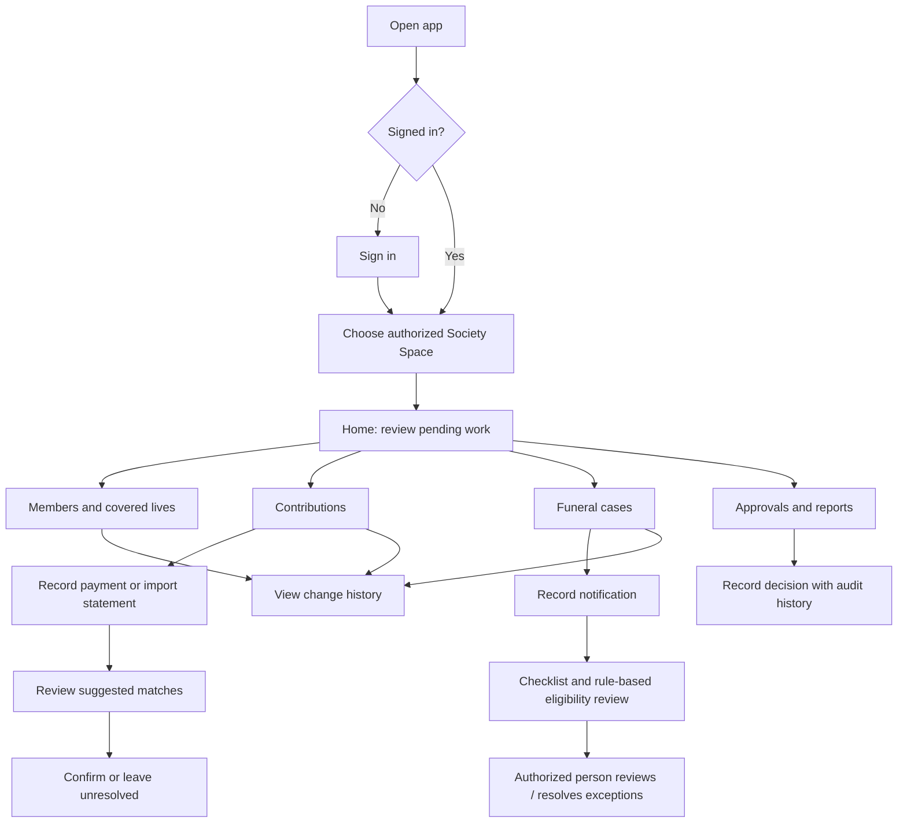
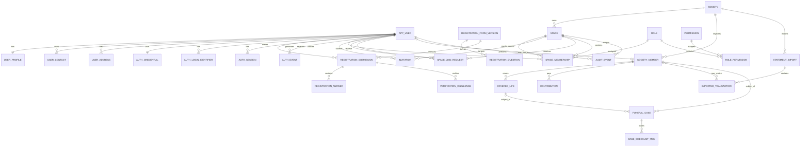

# Funeral Spaces — Society Space Product Requirements & Design Proposal

**Status:** Draft proposal for discussion — not an approved product specification  
**Prepared:** 19 October 2026  
**Product:** Funeral Spaces, South Africa  
**Platforms:** Android and iOS from the first release  
**Related source:** `Funeral_Spaces_Platform_Concept_and_Strategy.docx`

> This document turns the supplied concept into a visual-first planning artifact. Screen layouts, colors, roles, and flows below are recommendations to review—not research findings or final decisions. The current concept is the source for the proposed Phase 1 scope. Actual society workflows and South African funeral-practice variations still need validation with the people who perform them.

## 1. Product direction

### 1.1 Purpose of the Society Space

Give a self-managed funeral society a clear, trustworthy place to maintain its records and administer routine work: members and covered lives, contributions, reconciliation, committee approvals, and funeral notifications/claims. The app should make it easy to see what needs attention, who is responsible, and what has changed—without moving society funds into the platform or pretending software can make a binding benefit decision.

### 1.2 Design principles

1. **Next action first:** each important screen answers “What needs attention?” and offers an obvious next step.
2. **Trust through traceability:** show status, who changed a material record, when it changed, and the basis for a rule-based flag.
3. **Calm during stressful work:** use plain language, avoid alarmist language, and confirm consequential actions.
4. **Safe by default:** role-based access, least privilege, masked sensitive information, and no destructive gesture shortcuts.
5. **Works across Android and iOS:** shared visual system and behavior, with platform-appropriate navigation, system back behavior, keyboard handling, accessibility, and permission prompts.
6. **Future Spaces fit naturally:** keep shared app shell, identity, notifications, and case references consistent; keep each Space’s records and permissions distinct.
7. **Validate before automating:** software may show eligibility against society-approved rules, but exceptions and final decisions remain with authorized people.

## 2. Users and permission model

The following are **provisional role templates**, to validate with pilot societies. A person may hold more than one role, and a society must be able to configure permissions without giving every officer unrestricted access.

| Proposed role                     | Typical tasks                                                                    | Proposed access boundary                                                                                         |
| --------------------------------- | -------------------------------------------------------------------------------- | ---------------------------------------------------------------------------------------------------------------- |
| Society administrator / secretary | Maintain society profile, membership, covered lives, and approved rules          | Administrative access to assigned society records; sensitive actions separately permissioned                     |
| Treasurer                         | Record contributions, import statements, reconcile transactions, prepare reports | Financial records and reconciliation; cannot approve their own restricted withdrawal if separation is configured |
| Claims / funeral officer          | Record funeral notification, checklist, documents, status and decisions          | Assigned funeral cases; access limited to necessary member details                                               |
| Committee approver                | Review and record approvals or exceptions                                        | Assigned requests and decision history; no default access to unrelated records                                   |
| Member                            | View own permitted contribution/membership information and relevant updates      | Own records only; no access to committee or other members’ financial details                                     |

**Requirement:** every record and action must be scoped to a society and checked against the signed-in user’s permissions on the server, not only hidden in the mobile interface.

**Needs validation:** actual committee titles, role separation, quorum/approval rules, member verification, and who may view which information vary by society. Do not hard-code one society’s constitution as a universal workflow.

## 3. Proposed information architecture

### Main Society Space navigation

Five destinations are proposed for the Society Space:

- **Home** — summary, pending tasks, recent activity.
- **Members** — member and covered-life register.
- **Contributions** — schedules, receipts, arrears, statement import and reconciliation.
- **Funeral cases** — notifications, checklists, eligibility flags and progress.
- **More** — approvals, reports, society rules/profile, users and settings.

The top app bar shows the society name and an account/profile control. A **Spaces switcher** can be introduced in the shared shell, but should only show Spaces to which the user has access. In Phase 1, it can show Society Space only; later it can reveal linked Parlour, Family, or Supplier Spaces without merging their data or permissions.

**Platform behavior:** use a familiar bottom navigation pattern on both platforms, adapting visual details to Android and iOS conventions. Preserve state when switching tabs. Use the system back action for navigation; do not make a swipe gesture the only way to reach or dismiss important content.

## 4. Primary workflow map



### 4.1 Contribution reconciliation journey

1. Treasurer opens **Contributions** and sees the selected period plus totals for recorded, unmatched, and review-needed items.
2. Treasurer records a contribution manually or imports a supported bank statement file. The first release should not require a bank connection.
3. The app presents possible matches with the reason each match is suggested. Uncertain matches are visibly marked for review; the system must not silently post them as confirmed.
4. Treasurer reviews, edits, or leaves an item unresolved. Confirming a match previews the member, amount, date, and resulting ledger effect.
5. After confirmation, the app displays a receipt/reference and records who confirmed the entry and when. Corrections should preserve an audit trail rather than erase history.

### 4.2 Funeral notification / claim tracking journey

1. Authorized officer selects **New funeral notification** and searches for the member or covered life.
2. The officer enters only the initial information needed to open a case; save progress if the process is interrupted.
3. A case checklist is generated from that society’s configured rules and the case type selected. Each checklist item has a plain-language status and, where applicable, an assigned person.
4. The app shows an informational eligibility result and the rule basis used. Missing information or exceptions are routed to an authorized reviewer.
5. An authorized person records a decision and reason. The case timeline preserves status changes, actions, and corrections.
6. Family or parlour collaboration is not part of the Phase 1 internal Society Space unless separately approved and consented; later sharing should expose only specifically selected case data.

## 5. Visual design proposal

### 5.1 Color direction — proposed, not approved

A calm, dignified palette is proposed: deep green for primary actions and trust, warm off-white for comfortable reading, and restrained amber for emphasis. Avoid using color alone to convey status; always pair it with text and an icon/shape.

| Token                | Proposed value | Use                                                               |
| -------------------- | -------------- | ----------------------------------------------------------------- |
| Primary / deep green | `#174B3A`      | Main action, selected navigation, links on light surfaces         |
| Primary pressed      | `#10392D`      | Pressed/active state                                              |
| Warm background      | `#F7F4EE`      | App background                                                    |
| Surface              | `#FFFFFF`      | Cards, sheets, forms                                              |
| Text primary         | `#202521`      | Main text                                                         |
| Text secondary       | `#59625C`      | Supporting text                                                   |
| Accent / amber       | `#D6A84F`      | Small highlights; not body text on white unless contrast verified |
| Success              | `#287A52`      | Confirmed/success status with label                               |
| Warning              | `#A65B00`      | Needs review/attention status with label                          |
| Error                | `#B42318`      | Errors or destructive confirmation only, with label               |
| Divider / border     | `#D9DED9`      | Field and card boundaries                                         |

**Design check before approval:** verify WCAG contrast for actual text, icons, focus, disabled, and pressed states. The palette is a starting direction and should be tested with real users, including on low-quality displays and in bright outdoor light.

### 5.2 Typography and layout

- Use a clean, highly legible system sans-serif; follow Android/iOS text rendering and dynamic text sizing.
- Use sentence case and familiar words. Define society-specific terms in context rather than relying on insurance terminology.
- Use one clear page title, descriptive section headings, and readable body text. Avoid dense tables on phone screens; use stacked records and filters.
- Use generous spacing between touch targets and form fields. Keep important primary actions visible without obscuring content.
- Support screen readers, text scaling, keyboard navigation where relevant, clear focus, and reduced-motion preferences.

### 5.3 Buttons and controls

- **Primary button:** one prominent filled button per screen for the main task, e.g. “Add member” or “Review matches”.
- **Secondary button:** outlined or text button for a lower-priority action, e.g. “Save draft”.
- **Destructive action:** text/icon action with an explicit confirmation and explanation; never trigger from a swipe alone.
- **Status chips:** short text labels such as “Needs review”, “Pending”, “Confirmed”, and “Resolved”; use color plus label, not color alone.
- **Form controls:** persistent labels above fields, examples/help text where needed, inline validation, appropriate numeric/date keyboards, and clear optional/required marking.
- **Search/filter:** visible where lists can grow; filters open as a sheet with applied-filter summary and a clear reset action.

## 6. Screen-by-screen design

The wireframes are illustrative phone layouts, not final pixel designs. `[...]` denotes a tappable control or content row.

### 6.1 Sign-in

**Purpose:** give invited users a secure, low-friction route into only the societies/Spaces they are authorized to access.

```text
┌──────────────────────────────┐
│          FUNERAL SPACES      │
│                              │
│  Welcome back                │
│  Sign in to continue         │
│                              │
│  Email or username           │
│  [________________________]  │
│                              │
│  Password             [Show] │
│  [________________________]  │
│                              │
│  [       Log in             ] │
│                              │
│  [Sign up]                   │
│  Privacy                     │
└──────────────────────────────┘
```

**Behavior:** an existing user signs in with their username/email and password; their email address or cell phone was verified during registration. Screen 1 presents the username/email field, password field, login button, and a **Sign up** link. Do not send an OTP during ordinary sign-in. New users follow the sign-up flow, complete the registration form, and submit it for account creation. Only after account details are successfully registered does the service send a single-use, expiring OTP to the user's selected email or cell phone for verification. Registration asks for name, surname, location, selected Space, the selected Space's additional questions, email, cell phone, address, preferred name, password, and password confirmation. Space-specific questions are managed by the selected Space; the current mobile questions are prototype examples, not final business rules. A registration is not complete or trusted until the post-creation OTP is verified.

**Confirmed by user (26 October 2026; updated):** use username/email and password for sign-in after registration verification; do not send OTP at sign-in. During sign-up, users provide the stated profile, contact, Space-selection, and password fields. After successful account registration, verify either the cell phone or email using OTP. The app preview only models this sequence; real account creation and code delivery require a backend/provider. The previously confirmed account-versus-membership separation, invitations/Spaces landing screen, English pilot, and SMS/email verification channels remain in effect. Password recovery, session policy, identity/OTP provider, role boundaries, offline requirements, member-data visibility, and final Space-specific questions still require decisions.

### 6.2 Society selection / Spaces switcher

```text
┌──────────────────────────────┐
│ Your Spaces             [👤] │
│                              │
│ [Invitation from: Society A] │
│ [Review invitation] [Later]  │
│                              │
│ Your Spaces                  │
│ No Spaces yet                │
│                              │
│ Find a Space to join          │
│ [Search by name / code]      │
│ [Available Space result  >]  │
│                              │
│ Home   Members   ...          │
└──────────────────────────────┘
```

This is the post-authentication landing screen, whether the user registered independently or accepted an invitation. Separate **Your Spaces** (active memberships) from **Find a Space** (discoverable spaces the user has not joined). Selecting an invitation opens a clear confirmation sheet showing the Space, inviter, proposed role, and access summary; accepting activates the membership after validation, while declining/reviewing later is explicit. If multiple invitations exist, show a notification badge and an invitation list rather than hiding any in a single modal.

For a discoverable Space, the user opens its public profile and submits the minimum Space-specific required information using a Space-managed join form. The user is not marked as a member and cannot access private records merely by submitting the form. **Proposed secure default:** create a pending join request that an authorized Space administrator reviews; access begins only after approval. Automatic admission is a separate per-Space policy requiring explicit authorization and abuse controls. Do not expose private member lists, financial data, or funeral cases in the discovery screen.

Existing memberships can be selected to enter that Space:

```text
┌──────────────────────────────┐
│ Your Spaces             [👤] │
│                              │
│ Society A          Treasurer│
│ [Open Society Space       >] │
│                              │
│ Society B             Member│
│ [Open Society Space       >] │
│                              │
│ Find a Space to join          │
│ [Search by name / code]      │
└──────────────────────────────┘
```

Do not silently skip this landing screen after sign-in: users may need to review invitations or choose another Space. Show only Spaces already joined in **Your Spaces**; invitations and pending join requests have distinct, explicit statuses. Later Parlour, Family, and Supplier Spaces use the same hub shell while preserving separate permissions and data.

### 6.3 Home dashboard

```text
┌──────────────────────────────┐
│ Society name          [👤]   │
│ Society Space                 │
│                              │
│ Good morning                 │
│ Here is what needs attention │
│                              │
│ [ 3 items need review  > ]   │
│                              │
│ Contributions  [View]        │
│ This period: summary*        │
│                              │
│ Funeral cases   [View]       │
│ 1 active  ·  2 awaiting info  │
│                              │
│ [ + Record contribution ]    │
│ [ + New funeral notification]│
│                              │
│ Recent activity              │
│ • Member record updated      │
│ • Statement imported         │
│                              │
│ Home Members Contrib Cases More│
└──────────────────────────────┘
```

`*` Display actual totals only when the user has permission and the data is current; show the period and last-updated time. Avoid invented or misleading financial totals. Empty state should explain how to get started and show only actions allowed for that role. When offline capability is implemented, show a persistent, understandable sync state such as “Offline — changes saved on this device” only for operations confirmed to be safely stored locally.

### 6.4 Members list and search

```text
┌──────────────────────────────┐
│ Members              [ + Add]│
│ [ Search name / member no. ] │
│ [Status ▾] [Sort ▾]          │
│                              │
│ Active members               │
│ A. Example          Active > │
│ Member no. •••• 4821         │
│                              │
│ B. Example          Review >│
│ Member no. •••• 1063         │
│                              │
│ [Load more / page controls]  │
│ Home Members Contrib Cases More│
└──────────────────────────────┘
```

Show only minimum identifying detail in the list. Mask member numbers by default. Search must respect access rights and avoid exposing records in previews/notifications. Provide an accessible add button and empty/search-no-results states.

### 6.5 Member profile and covered lives

```text
┌──────────────────────────────┐
│ ‹ Members       [More •••]   │
│ A. Example      Active       │
│ Member no. •••• 4821         │
│                              │
│ [Overview] [Covered lives]   │
│                              │
│ Membership details           │
│ Joined date        [value]   │
│ Contribution status [value]  │
│                              │
│ Covered lives (3)            │
│ Name • relationship • status │
│ [ + Add covered life ]      │
│                              │
│ [Edit member]                │
│ Change history >             │
└──────────────────────────────┘
```

Use a form for add/edit with clear relationships and effective dates, but confirm which fields the society needs. Before saving, summarize the change and preserve previous values in the audit history. Do not imply that a covered-life entry alone guarantees a benefit.

### 6.6 Contributions overview

```text
┌──────────────────────────────┐
│ Contributions       [Period ▾]│
│                              │
│ [Overview] [Transactions]   │
│                              │
│ Recorded this period  [value]│
│ Needs matching        [value]│
│ Review required       [value]│
│                              │
│ [ + Record contribution ]    │
│ [ Import statement ]         │
│                              │
│ Recent transactions          │
│ Date • member • amount • status│
│                              │
│ Reconciliation history >    │
│ Home Members Contrib Cases More│
└──────────────────────────────┘
```

Use a selectable period and clearly indicate whether values are captured, matched, or confirmed. Manual entry must include a preview and confirmation to prevent wrong-member/amount posting. The app records the source and responsible user.

### 6.7 Statement import and match review

**Import screen:** describe supported file types only after confirmed; explain whether the file is uploaded or processed locally; preview the selected filename and period; show a progress indicator, cancellation where safe, and a clear error/retry path. Avoid implying direct bank access in Phase 1.

**Match-review screen:**

```text
┌──────────────────────────────┐
│ ‹ Contributions              │
│ Review imported transactions │
│ 12 of 28 • 4 need a decision │
│                              │
│ R 250.00  • 12 Oct           │
│ Suggested member: A. Example │
│ Why suggested: amount/date*  │
│ [Choose member] [Not a match]│
│                              │
│ [Confirm match]              │
│ [Leave for later]            │
│                              │
│ Previous      Next            │
└──────────────────────────────┘
```

`*` Only show reasons the system actually uses. On confirmation, show a compact final review with member, amount, date, and impact; then confirm. Ambiguous matches must stay unresolved. Support undo/correction through a traceable reversal, not by silently deleting the original.

### 6.8 Funeral cases list and case detail

**List:** search/filter by status and period; show minimal member/case reference and next action; no sensitive details in push previews.  
**Case detail:** summary, status timeline, checklist, assigned officer, rule-based eligibility information (with rule version/source), documents permitted for the role, notes, and authorized actions. Each status must have a definition and clear next step.

```text
┌──────────────────────────────┐
│ ‹ Funeral cases        [•••] │
│ Case reference • Open        │
│ Member / covered person      │
│                              │
│ Next step                    │
│ [Review missing information] │
│                              │
│ Checklist                    │
│ ✓ Notification recorded      │
│ ! Document needed     [View] │
│ ○ Authorized review pending  │
│                              │
│ Rule check: Needs review     │
│ Basis: [society rule name]   │
│ This is not a final decision.│
│                              │
│ Activity and decisions >     │
│ [Add update] [Record review] │
└──────────────────────────────┘
```

A final decision action should require an authorized role, a clear decision value, and a reason where appropriate. For exceptions, route to an authorized committee member. The UI must not present an automated flag as insurance approval or guaranteed benefit.

### 6.9 Approvals and requests

Show pending approvals, request context, requester, created date, and the exact authority/rule required. Approve/decline actions should have separate controls and a confirmation sheet that records the actor, time, decision, and optional reason. If the user lacks authority or required approval count is unmet, disable the action with an explanation. Separation-of-duties rules must be configurable and validated.

### 6.10 Reports and activity history

Start with reports listed in the Society concept: monthly contribution/arrears and operational funeral-case status, subject to role permission and validated definitions. Provide reporting period, generated time, filters, export preview, and safeguards for sensitive fields. Activity history should be searchable/filterable by actor, date, record type, and action; preserve correction/reversal records. Define data-retention and export rules before launch.

### 6.11 Settings and society rules

Society profile, user roles, approved rules/constitution references, notification preferences, help, privacy, and sign-out. Rule configuration should be separate from day-to-day claim processing, versioned, and restricted to authorized administrators. Show a rule’s effective date and approval history. Require an explicit review step before a rule change takes effect.

### 6.12 Account registration, OTP verification, and invitations

Users can create an app account with or without a Space invitation. Registration alone creates no Space membership and grants no private data access.

**Account creation screen**

```text
┌──────────────────────────────┐
│ Create your account          │
│                              │
│ Full name                    │
│ [________________________]   │
│ Email address                │
│ [________________________]   │
│ Phone number                 │
│ [________________________]   │
│                              │
│ Verify with                  │
│ (•) Email code  ( ) SMS code │
│                              │
│ [Send verification code]     │
│ Already registered? Log in   │
│ Privacy notice • Terms       │
└──────────────────────────────┘
```

The account identity fields should be minimized and the exact required profile fields need review. At least one selected contact channel must be verified; support email OTP and SMS phone OTP. Where both channels have been verified, the user may choose the channel for the OTP. Do not claim that an unverified contact method can be used for recovery.

**OTP verification screen**

```text
┌──────────────────────────────┐
│ Check your email / messages  │
│ Code sent to [masked contact]│
│                              │
│ [ _ ] [ _ ] [ _ ] [ _ ] [ _ ] [ _ ]
│                              │
│ [Verify code]                │
│ Resend code in 00:30         │
│ Use another verified method │
└──────────────────────────────┘
```

After verification, create the account/session and take the user to the **Spaces screen**. If the registration started from a valid invitation, show its Space, inviter, proposed role, and access summary for explicit acceptance; do not silently accept it. For an existing account, authenticate and link the invitation without creating a duplicate account. Expired, revoked, reused, or mismatched invitations need a safe recovery path.

An invitation notification on the Spaces screen opens a review sheet with **Accept invitation**, **Decline**, and **Later** actions. Accepting links membership to the existing account only after the invitation and target role are validated. Authorized Space administrators send invitations; the user can also create an account first and later join a discoverable Space through a join request.

## 7. Interaction patterns: sheets, dialogs, and gestures

### Bottom sheets

Use a bottom sheet for short contextual choices: filter options, sort, a concise action menu, or selecting a member. Provide a clear title, close control, visible primary action where applicable, and preserve the prior screen state. On iOS and Android, make dismissal behavior familiar; users must also have an explicit close/cancel option.

### Dialogs / pop-ups

Reserve modal dialogs for consequential confirmation or blocking decisions, not routine information. Examples: confirming a contribution post, approving a request, leaving an unsaved form, or signing out. State the consequence in plain language. Use a full-screen form for longer or multi-step tasks rather than squeezing them into a pop-up. Errors should appear near the relevant field or in a dismissible, accessible message with recovery steps.

### Swipe and scroll

- **Vertical scroll:** standard for long pages and lists; keep primary actions available without trapping content.
- **Pull down to refresh:** optional on dashboard/list screens only when refresh is meaningful; show progress and last-updated time.
- **Swipe actions on records:** do not use for approve, delete, post, or other consequential operations. Prefer explicit buttons/menus. If a future low-risk shortcut is added, duplicate it in a visible menu and provide undo.
- **Bottom sheets:** may be dragged to expand/dismiss only when an explicit close control is also available.
- Do not rely on gestures alone; provide accessible tap controls and respect system edge/back gestures.

## 8. States and feedback every screen must support

- Initial loading, refreshing, empty, no search results, permission denied, offline, stale data, save success, validation error, service error, and retry.
- For pending sync (if offline editing is approved): distinguish **saved on device**, **waiting to sync**, **synced**, and **sync conflict**; never tell the user a server update succeeded before confirmation.
- Preserve entered form values after recoverable errors. Warn before losing unsaved changes.
- For sensitive actions, show clear progress and prevent accidental double-submission; server operations need idempotent handling.
- Notifications should avoid exposing sensitive personal details on a locked screen. Notification preferences and purpose must be explicit.

## 9. Functional requirements and acceptance checks

### Phase 1 functional requirements

1. Society administrator can create/configure the society profile and approved rules, with change history.
2. Authorized user can create, find, view, update, and deactivate member records while preserving the audit trail.
3. Authorized user can maintain covered lives, relationships, and effective dates, with change history.
4. Treasurer can record contributions manually, issue/find receipts, and view transaction history.
5. Treasurer can import a validated statement format and review suggested matches; uncertain matches cannot be auto-confirmed.
6. Authorized officers can open and track funeral notifications/cases, use society-configured checklists, and refer exceptions for review.
7. Committee permissions support recording approval decisions and retaining the actor, timestamp, and decision history.
8. Members can see only their own approved contribution/membership information if the society enables member access.
9. Role checks apply on every server request; unauthorized access is denied and logged appropriately.
10. The app supports Android and iOS with consistent workflows and platform-specific usability checks.
11. Authorized administrators can invite, resend, revoke, and review invitations for a specific Space and role; invitees can activate an account or link an existing account.
12. Users can sign in, sign out, and recover access using the approved identity provider and recovery policy; no real authentication is implied until the provider is integrated.
13. An account is separate from a society member record. Account creation or invitation acceptance must not create an unapproved society membership or expose another member's data.
14. The backend uses PostgreSQL schema migrations for the approved Phase 1 entities; migrations are repeatable in development/test and controlled in staging/production.
15. Application data access is tenant/Space-scoped server-side. Database constraints enforce referential integrity and prevent duplicate invitation acceptance or duplicate contribution posting.
16. Audit history records relevant account activation, invitation, role, access revocation, and business-record changes without storing credentials or raw invitation secrets.

### Acceptance checks for key flows

- A treasurer can enter a contribution, review its member/date/amount, confirm it once, and locate the resulting record and audit entry.
- An uncertain imported item remains pending until a person resolves it; its suggested match reason is visible.
- A user without case permission cannot open case details by typing or receiving a deep link.
- An eligibility check displays its configured basis and cannot be mistaken for a final benefit decision.
- A committee decision is attributable and correction does not erase the original event.
- On both platforms, text scaling and screen reader labels keep core actions understandable; no core action depends exclusively on color or gesture.
- A network error does not falsely show a server-side success. Offline behavior must match the separately approved storage/sync design.
- A valid single-use invitation activates only the named Space membership and proposed role; expired, revoked, reused, or mismatched invitations are rejected safely.
- An existing account can accept a new Space invitation without duplicating the account; its permissions remain isolated by Space.
- A database migration can create/update the approved schema in a clean test database and be verified without production data or secrets.
- Repeating an import/post request cannot create a duplicate contribution, and a correction preserves the original record in the audit/reversal history.

## 10. Cross-Space design architecture

The app should look and behave like one coherent product without making all Spaces one shared permission domain.

### Shared across Spaces

- Account identity, sign-in and recovery patterns.
- Platform-aware app shell, navigation, typography, buttons, status components, accessibility, and feedback.
- Notification inbox and user preferences, with permissions and minimal sensitive content.
- Shared case reference and consent/permission handoff for a linked funeral journey.
- Audit conventions and consistent status language where the underlying meanings truly match.

### Specific to each Space

- Society membership, contribution ledger, rules, committee approvals, and internal claims records.
- Parlour catalogues, quotations, bookings, invoices, and fulfilment.
- Family tasks, invited relatives, selected documents, and family-visible case updates.
- Supplier service catalogue, accepted orders, delivery and fulfilment.

### Connection rule

When a funeral case connects Spaces, show what information is shared, with whom, for what purpose, and for how long. Access should be granted by an authorized person and be revocable where appropriate. A family should not receive society committee/financial records; a supplier should receive only the information needed for an assigned order. Data sharing, consent basis, retention, and legal obligations require product and legal validation before implementation.

## 11. Non-functional requirements

- Secure transport and storage, managed secrets, robust authorization, audit logging, and tested backup/recovery.
- Minimize sensitive data in local storage, notifications, analytics, logs, and crash reports.
- Plan POPIA-compliant purposes, access/correction, retention/deletion, data-subject requests, and incident response with qualified legal/privacy guidance.
- Low-bandwidth usability: lightweight screens, clear loading, resumable work where safe, and no unnecessary large downloads.
- Offline support is a product question to validate. If supported, define data classification, encryption, device sharing/logout behavior, sync/conflict rules, remote session revocation, and recovery before enabling sensitive edits.
- **Confirmed:** English is the first-pilot language. Structure copy for future localization and validate other language needs before adding them.
- Test on representative lower-cost Android devices and current supported iPhones once device support targets are chosen.

## 12. Out of scope for the first Society Space release (proposed)

- Full supplier marketplace and open provider discovery.
- AI funeral assistant.
- Holding/pooling society funds or initiating bank transfers.
- Insurance underwriting or binding claims adjudication.
- Automatic confirmation of uncertain bank matches.
- Broad cross-Space sharing without explicit scope, authorization, and review.
- Highly complex analytics before core data quality is proven.

## 13. Phase 1 authentication and registration requirements

### 13.1 Confirmed Phase 1 registration and Spaces journey

The user confirmed that registration is allowed with or without an invitation. A person may have a Funeral Spaces account without being a member of any Space. Registration creates the account only; it does not silently create society membership or grant access to private records. Sign-up collects name, surname, location, selected Space, Space-specific questions, email, cell phone, address, preferred name, password, and password confirmation.

1. New user chooses **Sign up**, completes and submits the registration form, and the service creates the account in a pending-verification state only after successful registration. Then the user verifies either the email address or cell phone using the OTP sent after account creation. Do not send an OTP as part of ordinary login. Registration alone creates no Space membership or private-data access.
2. If registration began from an invitation, the user reviews the Space, inviter, proposed role, and permissions, then accepts or declines. Accepting a valid invitation activates only that Space membership and role.
3. If registration began without an invitation, the account is created with no Space membership and the user is taken to the Spaces screen.
4. The Spaces screen shows active memberships, pending invitations, pending join requests, and discoverable Spaces as clearly separate sections/states.
5. User may search for a discoverable Space, inspect its public profile, provide that Space’s required join information, and submit a join request.
6. **Proposed security rule:** a no-invitation join request remains pending until reviewed by an authorized Space administrator. The account is not “marked” as a member and receives no private Space access while pending. Automatic admission requires a separately approved policy and abuse controls.

An existing user can receive invitations later. The Spaces screen must show a visible invitation notification and allow the user to review, accept, or decline it. Authorized Space administrators can send invitations; sending an invitation and accepting one are separate auditable actions.

The user confirmed that Phase 1 member accounts are allowed; access is still controlled by Space membership and permissions. Society self-registration/creation is distinct from a user account and remains unavailable unless a controlled society-onboarding flow is separately approved.

### 13.1.1 English and visual decisions confirmed

- Initial release language: English. Keep text structured for future localization.
- Keep the existing Society Space navigation: Home → Members → Contributions → Funeral cases → More for Phase 1; revisit in enhancement phases.
- The green palette is acceptable for Phase 1. Defer exploration of alternate palettes to an enhancement phase; existing contrast/accessibility checks still apply.

### 13.2 Sign-in and session flow

1. User enters their registered username/email and password. No OTP is sent during normal login because the contact channel was verified during registration.
2. The authentication service checks the password securely and applies generic errors, rate limits, and abuse monitoring to prevent account discovery and password guessing.
3. After successful authentication, the app obtains session credentials according to the selected security design and opens the Spaces landing screen for every account, including accounts with no membership.
4. The Spaces API response distinguishes active memberships, invitations that need review, pending join requests, and public/discoverable Spaces. It must not include private records for the latter three states.
5. Every protected API operation checks the authenticated account, active membership, role, permission, and Space scope server-side. Space context cannot carry permissions from one Space to another.
6. The app stores secrets only in platform-protected secure storage, never ordinary preferences, logs, analytics, or clipboard. Sign-out clears credentials and sensitive cached content per the approved device/offline policy; revoked or expired sessions return the user to a safe sign-in state.

### 13.3 Account and recovery requirements

- Support self-registration with account-only status, post-registration OTP verification over email or SMS, username/email + password sign-in, sign-out, approved password/account recovery, invitation resend/revoke/expiry, join-request submission/review, administrator-driven role change, and deactivation.
- Verify either the email or cell phone after successful account creation. The verified contact is used according to the approved recovery and notification policy; do not expose whether a contact is registered in user-facing error messages.
- Apply server-side rate limits and abuse monitoring to sign-in, recovery, and invitation endpoints. Use generic failure responses and avoid account enumeration.
- Prefer a vetted identity provider or carefully reviewed authentication service. Never store plaintext passwords. Use a recognized password-hashing implementation and professional security review—never custom cryptography.
- Define session expiry, refresh, revocation after role/account changes, lost/shared phones, and simultaneous-device behavior before release.
- Consider multi-factor authentication for privileged roles as a risk-based decision; confirm usability, recovery, and support impact before requiring it.
- Avoid sensitive case, membership, or contribution details in lock-screen notifications and sign-in error text.
- Record security-relevant events (invitation lifecycle, role changes, recovery, account deactivation, and appropriate sign-in events) without logging passwords, access tokens, or unnecessary personal data.
- Google/Facebook buttons in the visual mockup remain non-functional until social sign-in is explicitly approved, configured, and tested.

### 13.4 Authentication acceptance checks

- An uninvited person can create an account and see the Spaces landing screen but cannot access a Society Space’s private records by creating an account or guessing an identifier.
- A user with no membership can view only Space discovery/profile information explicitly made public and submit a join request; the request does not grant membership or private access.
- After every successful sign-in or registration, the app opens the Spaces landing screen and clearly distinguishes active Spaces, invitations, pending requests, and discoverable Spaces.
- A valid invitation is single-use, expires, can be revoked, and grants only the reviewed Space and role.
- An invitee with an existing app account can accept an invitation without producing a duplicate account.
- A deactivated user or revoked Space membership loses access on subsequent API requests, including old deep links.
- Sign-in and recovery errors do not reveal whether an account exists; repeated attempts are rate-limited.
- Session credentials are not stored in ordinary local preferences or written to logs.
- Changing active Space never exposes records from another Space, and every server request enforces membership and permissions.
- Recovery, expiry, lost-device, and session-revocation flows are tested on Android and iOS before production release.

## 14. Phase 1 database creation and design

### 14.1 Database approach

**Provisional recommendation:** PostgreSQL on the server, with schema changes managed through versioned migrations. Relational constraints fit the links between societies, accounts, roles, members, covered lives, contributions, and funeral cases. Flutter communicates with the backend API; it must not connect directly to PostgreSQL.

Create separate development, test, staging, and production environments. Production credentials must be managed outside source control. Use encrypted connections, least-privilege database accounts, automated backups, tested restore procedures, monitoring, and a documented retention/deletion policy. Do not use live member or funeral data in development/test environments; use synthetic or properly de-identified data.

The initial database foundation uses first-party email/username + password authentication, pending selection of the production identity service. It separates account, profile, address, contact, login identifier, and password credential data. Password credentials contain only a vetted password hash—not plaintext or reversibly encrypted passwords. If a hosted identity provider is chosen instead, replace or adapt these credentials/login-identifier tables to store the provider's stable subject mapping. Authentication logic, password hashing, OTP delivery, and sessions still require a dedicated security design and review.

### 14.2 Proposed relationship model



`APP_USER` is a platform account. `SOCIETY_MEMBER` is a society’s membership record. They are distinct: someone can be recorded as a member without app access; an app user may be an officer without being a society member; one user may eventually belong to multiple Spaces. Do not use an email address as a database primary key or assume it is permanently unique/unchangeable.

### 14.3 Proposed Phase 1 entities

| Table / entity                                            | Purpose and important fields (provisional)                                                                                                                                                                                                                                                                 |
| --------------------------------------------------------- | ---------------------------------------------------------------------------------------------------------------------------------------------------------------------------------------------------------------------------------------------------------------------------------------------------------- |
| `app_user`                                                | Internal account profile: UUID, display name, verified contact references as needed, status, created/updated timestamps. Avoid unnecessary duplicate personal data.                                                                                                                                        |
| `user_profile`, `user_address`, `user_contact`            | Normalized personal profile, address/location, and email/phone contact rows. Contact rows carry verification and primary-contact state; globally unique normalized values prevent duplicate email/phone accounts.                                                                                          |
| `auth_login_identifier`, `auth_credential`                | Normalized unique username lookup plus a separate credential row containing a password hash and login counters/lockout fields. Email login resolves using a verified email contact. No plaintext passwords.                                                                                                |
| `registration_form_version`, `registration_question`      | Space-type registration form versions and the questions asked for that version. A versioned form preserves the meaning of submitted answers if prompts change later.                                                                                                                                       |
| `registration_submission`, `registration_answer`          | Pending/verified account-registration attempt, selected Space type, chosen contact to verify, and one row per answer linked to the exact versioned question. This selection is not a Space membership.                                                                                                     |
| `verification_challenge`                                  | Keyed OTP hash, purpose, delivery state, expiry, attempt counters, consumption/invalidation metadata; no plaintext OTP. Delivery begins after successful pending-account registration is committed.                                                                                                        |
| `auth_session`, `auth_event`                              | Hashed refresh-token sessions with expiry/revocation and a minimized account-security audit trail.                                                                                                                                                                                                         |
| `society`                                                 | Society workspace owner/tenant: UUID, display name, status, profile/constitution references, timestamps. Registration fields need validation.                                                                                                                                                              |
| `space`                                                   | Extensible workspace: UUID, owning society/organization reference, type (initially `society`), name, status. Future Space types must retain separate permissions.                                                                                                                                          |
| `role`, `permission`, `role_permission`                   | Role templates and permissions scoped to a Space type; society-specific overrides only if validated as necessary. Enforce in API policy, not only UI.                                                                                                                                                      |
| `space_membership`                                        | User-to-Space authorization: user UUID, Space UUID, role UUID, status, invited/activated/revoked timestamps and actor references.                                                                                                                                                                          |
| `invitation`                                              | Space, target contact, proposed role, token hash (never raw token), expiry, created/revoked/accepted timestamps, inviting actor, state. Tokens are random, single-use, expiring, and revocable.                                                                                                            |
| `space_join_request`                                      | User UUID, Space UUID, request state (`pending`, `approved`, `declined`, `withdrawn`), submission/review timestamps and actors, minimized review note, and a versioned snapshot/reference to the Space-defined required fields. Approval creates membership in a transaction; submission alone never does. |
| `space_join_request_value` (or structured profile fields) | Values submitted for the Space's required join form. Define allowed field types, purpose, retention, visibility, and optional/sensitive classification before collecting personal information; never expose submitted values to unrelated Spaces or applicants.                                            |
| `society_member`                                          | Society membership identity: UUID, society UUID, member number, necessary profile fields, status, join/leave dates. Member number unique per society; fields subject to privacy/workflow validation. Optional link to `app_user`.                                                                          |
| `covered_life`                                            | Covered person attached to a society member: relationship, effective dates, status, minimum identity fields the society needs. Listing does not guarantee benefit approval.                                                                                                                                |
| `contribution`                                            | Ledger entry: society/member references, amount as fixed-precision decimal, currency (ZAR where confirmed), payment date, source/status, receipt/reference, creator, and correction/reversal linkage. Never use floating point for money.                                                                  |
| `statement_import`, `imported_transaction`                | Import batch and parsed rows: source reference, period, checksum/idempotency key, import status, row amount/date/reference, suggested member, match reason/status, reviewer and confirmation state. Preserve original rows and review decisions.                                                           |
| `funeral_case`, `case_checklist_item`                     | Society-scoped notification/case and checklist/status timeline. Link to a society member or covered life; record assigned officer, rule version, and authorized review outcomes.                                                                                                                           |
| `society_rule_version`                                    | Versioned society-approved rules/checklist configuration with effective date, approver, approval timestamp, audit reference. Rule format and authority need validation.                                                                                                                                    |
| `audit_event`                                             | Append-only material action record: Space, actor, event type, target type/id, UTC timestamp, correlation ID, minimized change summary/reason. Never include secrets or unnecessary document contents.                                                                                                      |

Phase 1 may narrow this list after discovery. Preserve account/Space boundaries and auditability. Cross-Space sharing grants, parlour catalogue/quotes, family invitations, supplier orders, and marketplace tables belong to later phases unless validated pilot needs require them.

### 14.4 Data integrity and privacy rules

- Use UUID primary keys, foreign keys, check/unique constraints for invariants, and indexes for common queries (Space membership, member search, contribution period/status, case status/date, invitation lookup).
- Store timestamps in UTC and render locally; define date-only versus timestamp semantics for contribution dates, effective dates, and event timelines.
- Store money as fixed-precision numeric values with explicit currency; define rounding and reconciliation rules. Do not use floating-point types for financial amounts.
- Enforce tenant/Space scoping in every API query and write. Database row-level security may be evaluated after the connection/pooling model is understood and tested; it does not replace API authorization.
- Use soft deactivation where operational/audit requirements require history; define lawful retention and deletion/anonymization with privacy/legal guidance. Avoid indiscriminate deletion or indefinite retention.
- Do not place passwords, raw invitation tokens, access tokens, bank credentials, unnecessary bank files, or sensitive case details in logs or analytics. Restrict and audit document access separately.
- Imports and contribution posting must be idempotent: retrying cannot create duplicate ledger entries. Corrections use linked reversal/amendment events rather than erasing financial history.
- Define encrypted backups, restore testing, disaster recovery objectives, and access controls before storing real society data.

### 14.5 Database implementation and migration workflow

1. Confirm the Phase 1 user/account lifecycle, role boundaries, join-request approval policy, discovery visibility, and exact join-form fields with pilot societies.
2. Choose and document identity provider/authentication; decide which identity/profile data is mirrored in PostgreSQL.
3. Create local development database and least-privilege app role; never use production credentials locally.
4. Implement schema changes as ordered, version-controlled migrations with review and rollback/forward-fix guidance. Avoid manual production-only schema changes.
5. Apply migrations automatically in development/test and through a controlled release process in staging/production.
6. Seed synthetic demo data only. Test constraints, permissions, tenant isolation, invitation expiry/revocation, idempotency, audit history, backup restoration, and migration compatibility.
7. Document engine/version, migration status, backup policy, retention, monitoring, and recovery instructions for deployment.

**Not yet specified:** deployment provider/region, identity provider, member data fields, invitation channel, password/passkey policy, MFA policy, notification provider, session/device policy, retention periods, row-level security usage, and cross-Space consent record. Validate with product, operational, technical, and South African legal/privacy experts where relevant.

## 15. Decisions to review before design approval

### Confirmed by the user (26 October 2026)

1. Phase 1 Society Space navigation remains Home → Members → Contributions → Funeral cases → More through enhancement phases.
2. Retain the green palette for Phase 1; reconsider palettes during a later enhancement phase.
3. People may register with or without an invitation. A new account is not automatically assigned to a Space. Users can discover a Space and submit its required join information; invitations may also be sent and received/accepted.
4. After login/registration, all users land on the Spaces screen. Show a visible invitation notification when an invitation is pending and let the user review/confirm it.
5. Support both SMS phone OTP and email OTP.
6. English is the first-pilot language.
7. The user wants to work on registration/login and build the supporting APIs and databases.

### Still unresolved; do not silently decide

1. Which roles can send invitations, review/approve join requests, and assign roles; whether joins are always reviewed or can be automatically admitted; and how a first society administrator is verified.
2. Exact required join-form fields, Space discovery/search criteria, what information is public, and whether a user can submit multiple requests.
3. Whether users choose either verified OTP channel or a Space sets the channel; primary account identifier; provider for identity, OTP, email, and SMS; OTP lifetime/attempt settings; account recovery; and whether passwords/passkeys or privileged-user MFA are supported.
4. Session expiry, refresh/revocation, shared-device behavior, and device-loss recovery.
5. Offline behavior and the precise contribution/covered-life visibility available to members.
6. Society member data fields, privacy/retention policy, deployment provider/region, and exact production security controls.

Use pending review and no Space access as the conservative development behavior for a join request until an authorized approval policy is agreed. Keep OTP delivery behind a provider interface until the user selects an identity/OTP provider; do not ship mock codes as real authentication.

## 16. Review and change control

Record approved decisions with date, owner, and rationale. Keep unresolved items visibly unresolved. Update the implementation plan and learning journal when a major design decision is approved. Do not treat this proposal as a legal, regulatory, security, or society-governance approval.
