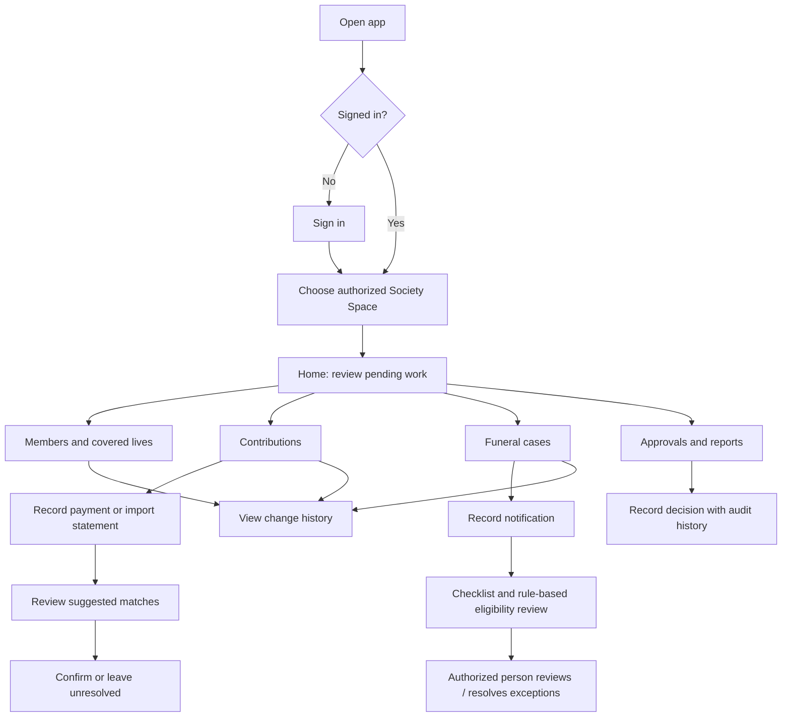

# Funeral Spaces — Society Space Product Requirements & Design Proposal

**Status:** Draft proposal for discussion — not an approved product specification  
**Prepared:** 19 October 2026  
**Product:** Funeral Spaces, South Africa  
**Platforms:** Android and iOS from the first release  
**Related source:** `Funeral_Spaces_Platform_Concept_and_Strategy.docx`

> This document turns the supplied concept into a visual-first planning artifact. Screen layouts, colors, roles, and flows below are recommendations to review—not research findings or final decisions. The current concept is the source for the proposed Phase 1 scope. Actual society workflows and South African funeral-practice variations still need validation with the people who perform them.

## 1. Product direction

### 1.1 Purpose of the Society Space

Give a self-managed funeral society a clear, trustworthy place to maintain its records and administer routine work: members and covered lives, contributions, reconciliation, committee approvals, and funeral notifications/claims. The app should make it easy to see what needs attention, who is responsible, and what has changed—without moving society funds into the platform or pretending software can make a binding benefit decision.

### 1.2 Design principles

1. **Next action first:** each important screen answers “What needs attention?” and offers an obvious next step.
2. **Trust through traceability:** show status, who changed a material record, when it changed, and the basis for a rule-based flag.
3. **Calm during stressful work:** use plain language, avoid alarmist language, and confirm consequential actions.
4. **Safe by default:** role-based access, least privilege, masked sensitive information, and no destructive gesture shortcuts.
5. **Works across Android and iOS:** shared visual system and behavior, with platform-appropriate navigation, system back behavior, keyboard handling, accessibility, and permission prompts.
6. **Future Spaces fit naturally:** keep shared app shell, identity, notifications, and case references consistent; keep each Space’s records and permissions distinct.
7. **Validate before automating:** software may show eligibility against society-approved rules, but exceptions and final decisions remain with authorized people.

## 2. Users and permission model

The following are **provisional role templates**, to validate with pilot societies. A person may hold more than one role, and a society must be able to configure permissions without giving every officer unrestricted access.

| Proposed role                     | Typical tasks                                                                    | Proposed access boundary                                                                                         |
| --------------------------------- | -------------------------------------------------------------------------------- | ---------------------------------------------------------------------------------------------------------------- |
| Society administrator / secretary | Maintain society profile, membership, covered lives, and approved rules          | Administrative access to assigned society records; sensitive actions separately permissioned                     |
| Treasurer                         | Record contributions, import statements, reconcile transactions, prepare reports | Financial records and reconciliation; cannot approve their own restricted withdrawal if separation is configured |
| Claims / funeral officer          | Record funeral notification, checklist, documents, status and decisions          | Assigned funeral cases; access limited to necessary member details                                               |
| Committee approver                | Review and record approvals or exceptions                                        | Assigned requests and decision history; no default access to unrelated records                                   |
| Member                            | View own permitted contribution/membership information and relevant updates      | Own records only; no access to committee or other members’ financial details                                     |

**Requirement:** every record and action must be scoped to a society and checked against the signed-in user’s permissions on the server, not only hidden in the mobile interface.

**Needs validation:** actual committee titles, role separation, quorum/approval rules, member verification, and who may view which information vary by society. Do not hard-code one society’s constitution as a universal workflow.

## 3. Proposed information architecture

### Main Society Space navigation

Five destinations are proposed for the Society Space:

- **Home** — summary, pending tasks, recent activity.
- **Members** — member and covered-life register.
- **Contributions** — schedules, receipts, arrears, statement import and reconciliation.
- **Funeral cases** — notifications, checklists, eligibility flags and progress.
- **More** — approvals, reports, society rules/profile, users and settings.

The top app bar shows the society name and an account/profile control. A **Spaces switcher** can be introduced in the shared shell, but should only show Spaces to which the user has access. In Phase 1, it can show Society Space only; later it can reveal linked Parlour, Family, or Supplier Spaces without merging their data or permissions.

**Platform behavior:** use a familiar bottom navigation pattern on both platforms, adapting visual details to Android and iOS conventions. Preserve state when switching tabs. Use the system back action for navigation; do not make a swipe gesture the only way to reach or dismiss important content.

## 4. Primary workflow map



### 4.1 Contribution reconciliation journey

1. Treasurer opens **Contributions** and sees the selected period plus totals for recorded, unmatched, and review-needed items.
2. Treasurer records a contribution manually or imports a supported bank statement file. The first release should not require a bank connection.
3. The app presents possible matches with the reason each match is suggested. Uncertain matches are visibly marked for review; the system must not silently post them as confirmed.
4. Treasurer reviews, edits, or leaves an item unresolved. Confirming a match previews the member, amount, date, and resulting ledger effect.
5. After confirmation, the app displays a receipt/reference and records who confirmed the entry and when. Corrections should preserve an audit trail rather than erase history.

### 4.2 Funeral notification / claim tracking journey

1. Authorized officer selects **New funeral notification** and searches for the member or covered life.
2. The officer enters only the initial information needed to open a case; save progress if the process is interrupted.
3. A case checklist is generated from that society’s configured rules and the case type selected. Each checklist item has a plain-language status and, where applicable, an assigned person.
4. The app shows an informational eligibility result and the rule basis used. Missing information or exceptions are routed to an authorized reviewer.
5. An authorized person records a decision and reason. The case timeline preserves status changes, actions, and corrections.
6. Family or parlour collaboration is not part of the Phase 1 internal Society Space unless separately approved and consented; later sharing should expose only specifically selected case data.

## 5. Visual design proposal

### 5.1 Color direction — proposed, not approved

A calm, dignified palette is proposed: deep green for primary actions and trust, warm off-white for comfortable reading, and restrained amber for emphasis. Avoid using color alone to convey status; always pair it with text and an icon/shape.

| Token                | Proposed value | Use                                                               |
| -------------------- | -------------- | ----------------------------------------------------------------- |
| Primary / deep green | `#174B3A`      | Main action, selected navigation, links on light surfaces         |
| Primary pressed      | `#10392D`      | Pressed/active state                                              |
| Warm background      | `#F7F4EE`      | App background                                                    |
| Surface              | `#FFFFFF`      | Cards, sheets, forms                                              |
| Text primary         | `#202521`      | Main text                                                         |
| Text secondary       | `#59625C`      | Supporting text                                                   |
| Accent / amber       | `#D6A84F`      | Small highlights; not body text on white unless contrast verified |
| Success              | `#287A52`      | Confirmed/success status with label                               |
| Warning              | `#A65B00`      | Needs review/attention status with label                          |
| Error                | `#B42318`      | Errors or destructive confirmation only, with label               |
| Divider / border     | `#D9DED9`      | Field and card boundaries                                         |

**Design check before approval:** verify WCAG contrast for actual text, icons, focus, disabled, and pressed states. The palette is a starting direction and should be tested with real users, including on low-quality displays and in bright outdoor light.

### 5.2 Typography and layout

- Use a clean, highly legible system sans-serif; follow Android/iOS text rendering and dynamic text sizing.
- Use sentence case and familiar words. Define society-specific terms in context rather than relying on insurance terminology.
- Use one clear page title, descriptive section headings, and readable body text. Avoid dense tables on phone screens; use stacked records and filters.
- Use generous spacing between touch targets and form fields. Keep important primary actions visible without obscuring content.
- Support screen readers, text scaling, keyboard navigation where relevant, clear focus, and reduced-motion preferences.

### 5.3 Buttons and controls

- **Primary button:** one prominent filled button per screen for the main task, e.g. “Add member” or “Review matches”.
- **Secondary button:** outlined or text button for a lower-priority action, e.g. “Save draft”.
- **Destructive action:** text/icon action with an explicit confirmation and explanation; never trigger from a swipe alone.
- **Status chips:** short text labels such as “Needs review”, “Pending”, “Confirmed”, and “Resolved”; use color plus label, not color alone.
- **Form controls:** persistent labels above fields, examples/help text where needed, inline validation, appropriate numeric/date keyboards, and clear optional/required marking.
- **Search/filter:** visible where lists can grow; filters open as a sheet with applied-filter summary and a clear reset action.

## 6. Screen-by-screen design

The wireframes are illustrative phone layouts, not final pixel designs. `[...]` denotes a tappable control or content row.

### 6.1 Sign-in

**Purpose:** give invited users a secure, low-friction route into only the societies/Spaces they are authorized to access.

```text
┌──────────────────────────────┐
│          FUNERAL SPACES      │
│                              │
│  Welcome back                │
│  Sign in to continue         │
│                              │
│  Email or username           │
│  [________________________]  │
│                              │
│  Password             [Show] │
│  [________________________]  │
│  [Forgot password?]          │
│                              │
│  [         Sign in         ] │
│                              │
│  Need access? Contact your   │
│  society administrator       │
│  Privacy   Help              │
└──────────────────────────────┘
```

**Behavior:** show/hide password control with accessible label; validate without clearing fields; generic sign-in error that does not reveal whether an account exists; loading and network-failure states; password reset; optional invite/activation flow. Offer another authentication method if adopted. Do not assume SMS one-time codes are the only option; decide after reviewing user access patterns, device sharing, recovery needs, costs, and security. Require stronger verification for sensitive actions only after the security approach is designed and tested.

**Unresolved:** sign-in identifier and verification method (email, phone, username, passkey, authenticator, or a combination), account recovery process, shared-device behavior, and whether members need self-registration. The concept describes organizational Spaces; open public sign-up is not assumed.

### 6.2 Society selection / Spaces switcher

```text
┌──────────────────────────────┐
│ Select a workspace           │
│                              │
│ [ Society name         > ]   │
│   Your role: Treasurer       │
│                              │
│ [ Join with invitation ]     │
│                              │
│ Only workspaces you are      │
│ authorized to access appear. │
└──────────────────────────────┘
```

If a user has one workspace, it may open directly after sign-in while keeping a visible workspace switcher in the app bar. Joining by invitation should verify the invite and show the society identity before accepting. Later Spaces can be listed here, with explicit labels and permissions.

### 6.3 Home dashboard

```text
┌──────────────────────────────┐
│ Society name          [👤]   │
│ Society Space                 │
│                              │
│ Good morning                 │
│ Here is what needs attention │
│                              │
│ [ 3 items need review  > ]   │
│                              │
│ Contributions  [View]        │
│ This period: summary*        │
│                              │
│ Funeral cases   [View]       │
│ 1 active  ·  2 awaiting info  │
│                              │
│ [ + Record contribution ]    │
│ [ + New funeral notification]│
│                              │
│ Recent activity              │
│ • Member record updated      │
│ • Statement imported         │
│                              │
│ Home Members Contrib Cases More│
└──────────────────────────────┘
```

`*` Display actual totals only when the user has permission and the data is current; show the period and last-updated time. Avoid invented or misleading financial totals. Empty state should explain how to get started and show only actions allowed for that role. When offline capability is implemented, show a persistent, understandable sync state such as “Offline — changes saved on this device” only for operations confirmed to be safely stored locally.

### 6.4 Members list and search

```text
┌──────────────────────────────┐
│ Members              [ + Add]│
│ [ Search name / member no. ] │
│ [Status ▾] [Sort ▾]          │
│                              │
│ Active members               │
│ A. Example          Active > │
│ Member no. •••• 4821         │
│                              │
│ B. Example          Review >│
│ Member no. •••• 1063         │
│                              │
│ [Load more / page controls]  │
│ Home Members Contrib Cases More│
└──────────────────────────────┘
```

Show only minimum identifying detail in the list. Mask member numbers by default. Search must respect access rights and avoid exposing records in previews/notifications. Provide an accessible add button and empty/search-no-results states.

### 6.5 Member profile and covered lives

```text
┌──────────────────────────────┐
│ ‹ Members       [More •••]   │
│ A. Example      Active       │
│ Member no. •••• 4821         │
│                              │
│ [Overview] [Covered lives]   │
│                              │
│ Membership details           │
│ Joined date        [value]   │
│ Contribution status [value]  │
│                              │
│ Covered lives (3)            │
│ Name • relationship • status │
│ [ + Add covered life ]      │
│                              │
│ [Edit member]                │
│ Change history >             │
└──────────────────────────────┘
```

Use a form for add/edit with clear relationships and effective dates, but confirm which fields the society needs. Before saving, summarize the change and preserve previous values in the audit history. Do not imply that a covered-life entry alone guarantees a benefit.

### 6.6 Contributions overview

```text
┌──────────────────────────────┐
│ Contributions       [Period ▾]│
│                              │
│ [Overview] [Transactions]   │
│                              │
│ Recorded this period  [value]│
│ Needs matching        [value]│
│ Review required       [value]│
│                              │
│ [ + Record contribution ]    │
│ [ Import statement ]         │
│                              │
│ Recent transactions          │
│ Date • member • amount • status│
│                              │
│ Reconciliation history >    │
│ Home Members Contrib Cases More│
└──────────────────────────────┘
```

Use a selectable period and clearly indicate whether values are captured, matched, or confirmed. Manual entry must include a preview and confirmation to prevent wrong-member/amount posting. The app records the source and responsible user.

### 6.7 Statement import and match review

**Import screen:** describe supported file types only after confirmed; explain whether the file is uploaded or processed locally; preview the selected filename and period; show a progress indicator, cancellation where safe, and a clear error/retry path. Avoid implying direct bank access in Phase 1.

**Match-review screen:**

```text
┌──────────────────────────────┐
│ ‹ Contributions              │
│ Review imported transactions │
│ 12 of 28 • 4 need a decision │
│                              │
│ R 250.00  • 12 Oct           │
│ Suggested member: A. Example │
│ Why suggested: amount/date*  │
│ [Choose member] [Not a match]│
│                              │
│ [Confirm match]              │
│ [Leave for later]            │
│                              │
│ Previous      Next            │
└──────────────────────────────┘
```

`*` Only show reasons the system actually uses. On confirmation, show a compact final review with member, amount, date, and impact; then confirm. Ambiguous matches must stay unresolved. Support undo/correction through a traceable reversal, not by silently deleting the original.

### 6.8 Funeral cases list and case detail

**List:** search/filter by status and period; show minimal member/case reference and next action; no sensitive details in push previews.  
**Case detail:** summary, status timeline, checklist, assigned officer, rule-based eligibility information (with rule version/source), documents permitted for the role, notes, and authorized actions. Each status must have a definition and clear next step.

```text
┌──────────────────────────────┐
│ ‹ Funeral cases        [•••] │
│ Case reference • Open        │
│ Member / covered person      │
│                              │
│ Next step                    │
│ [Review missing information] │
│                              │
│ Checklist                    │
│ ✓ Notification recorded      │
│ ! Document needed     [View] │
│ ○ Authorized review pending  │
│                              │
│ Rule check: Needs review     │
│ Basis: [society rule name]   │
│ This is not a final decision.│
│                              │
│ Activity and decisions >     │
│ [Add update] [Record review] │
└──────────────────────────────┘
```

A final decision action should require an authorized role, a clear decision value, and a reason where appropriate. For exceptions, route to an authorized committee member. The UI must not present an automated flag as insurance approval or guaranteed benefit.

### 6.9 Approvals and requests

Show pending approvals, request context, requester, created date, and the exact authority/rule required. Approve/decline actions should have separate controls and a confirmation sheet that records the actor, time, decision, and optional reason. If the user lacks authority or required approval count is unmet, disable the action with an explanation. Separation-of-duties rules must be configurable and validated.

### 6.10 Reports and activity history

Start with reports listed in the Society concept: monthly contribution/arrears and operational funeral-case status, subject to role permission and validated definitions. Provide reporting period, generated time, filters, export preview, and safeguards for sensitive fields. Activity history should be searchable/filterable by actor, date, record type, and action; preserve correction/reversal records. Define data-retention and export rules before launch.

### 6.11 Settings and society rules

Society profile, user roles, approved rules/constitution references, notification preferences, help, privacy, and sign-out. Rule configuration should be separate from day-to-day claim processing, versioned, and restricted to authorized administrators. Show a rule’s effective date and approval history. Require an explicit review step before a rule change takes effect.

## 7. Interaction patterns: sheets, dialogs, and gestures

### Bottom sheets

Use a bottom sheet for short contextual choices: filter options, sort, a concise action menu, or selecting a member. Provide a clear title, close control, visible primary action where applicable, and preserve the prior screen state. On iOS and Android, make dismissal behavior familiar; users must also have an explicit close/cancel option.

### Dialogs / pop-ups

Reserve modal dialogs for consequential confirmation or blocking decisions, not routine information. Examples: confirming a contribution post, approving a request, leaving an unsaved form, or signing out. State the consequence in plain language. Use a full-screen form for longer or multi-step tasks rather than squeezing them into a pop-up. Errors should appear near the relevant field or in a dismissible, accessible message with recovery steps.

### Swipe and scroll

- **Vertical scroll:** standard for long pages and lists; keep primary actions available without trapping content.
- **Pull down to refresh:** optional on dashboard/list screens only when refresh is meaningful; show progress and last-updated time.
- **Swipe actions on records:** do not use for approve, delete, post, or other consequential operations. Prefer explicit buttons/menus. If a future low-risk shortcut is added, duplicate it in a visible menu and provide undo.
- **Bottom sheets:** may be dragged to expand/dismiss only when an explicit close control is also available.
- Do not rely on gestures alone; provide accessible tap controls and respect system edge/back gestures.

## 8. States and feedback every screen must support

- Initial loading, refreshing, empty, no search results, permission denied, offline, stale data, save success, validation error, service error, and retry.
- For pending sync (if offline editing is approved): distinguish **saved on device**, **waiting to sync**, **synced**, and **sync conflict**; never tell the user a server update succeeded before confirmation.
- Preserve entered form values after recoverable errors. Warn before losing unsaved changes.
- For sensitive actions, show clear progress and prevent accidental double-submission; server operations need idempotent handling.
- Notifications should avoid exposing sensitive personal details on a locked screen. Notification preferences and purpose must be explicit.

## 9. Functional requirements and acceptance checks

### Phase 1 functional requirements

1. Society administrator can create/configure the society profile and approved rules, with change history.
2. Authorized user can create, find, view, update, and deactivate member records while preserving the audit trail.
3. Authorized user can maintain covered lives, relationships, and effective dates, with change history.
4. Treasurer can record contributions manually, issue/find receipts, and view transaction history.
5. Treasurer can import a validated statement format and review suggested matches; uncertain matches cannot be auto-confirmed.
6. Authorized officers can open and track funeral notifications/cases, use society-configured checklists, and refer exceptions for review.
7. Committee permissions support recording approval decisions and retaining the actor, timestamp, and decision history.
8. Members can see only their own approved contribution/membership information if the society enables member access.
9. Role checks apply on every server request; unauthorized access is denied and logged appropriately.
10. The app supports Android and iOS with consistent workflows and platform-specific usability checks.

### Acceptance checks for key flows

- A treasurer can enter a contribution, review its member/date/amount, confirm it once, and locate the resulting record and audit entry.
- An uncertain imported item remains pending until a person resolves it; its suggested match reason is visible.
- A user without case permission cannot open case details by typing or receiving a deep link.
- An eligibility check displays its configured basis and cannot be mistaken for a final benefit decision.
- A committee decision is attributable and correction does not erase the original event.
- On both platforms, text scaling and screen reader labels keep core actions understandable; no core action depends exclusively on color or gesture.
- A network error does not falsely show a server-side success. Offline behavior must match the separately approved storage/sync design.

## 10. Cross-Space design architecture

The app should look and behave like one coherent product without making all Spaces one shared permission domain.

### Shared across Spaces

- Account identity, sign-in and recovery patterns.
- Platform-aware app shell, navigation, typography, buttons, status components, accessibility, and feedback.
- Notification inbox and user preferences, with permissions and minimal sensitive content.
- Shared case reference and consent/permission handoff for a linked funeral journey.
- Audit conventions and consistent status language where the underlying meanings truly match.

### Specific to each Space

- Society membership, contribution ledger, rules, committee approvals, and internal claims records.
- Parlour catalogues, quotations, bookings, invoices, and fulfilment.
- Family tasks, invited relatives, selected documents, and family-visible case updates.
- Supplier service catalogue, accepted orders, delivery and fulfilment.

### Connection rule

When a funeral case connects Spaces, show what information is shared, with whom, for what purpose, and for how long. Access should be granted by an authorized person and be revocable where appropriate. A family should not receive society committee/financial records; a supplier should receive only the information needed for an assigned order. Data sharing, consent basis, retention, and legal obligations require product and legal validation before implementation.

## 11. Non-functional requirements

- Secure transport and storage, managed secrets, robust authorization, audit logging, and tested backup/recovery.
- Minimize sensitive data in local storage, notifications, analytics, logs, and crash reports.
- Plan POPIA-compliant purposes, access/correction, retention/deletion, data-subject requests, and incident response with qualified legal/privacy guidance.
- Low-bandwidth usability: lightweight screens, clear loading, resumable work where safe, and no unnecessary large downloads.
- Offline support is a product question to validate. If supported, define data classification, encryption, device sharing/logout behavior, sync/conflict rules, remote session revocation, and recovery before enabling sensitive edits.
- Support English initially only if that is explicitly agreed; identify language needs through validation rather than assuming. Structure copy for future localization.
- Test on representative lower-cost Android devices and current supported iPhones once device support targets are chosen.

## 12. Out of scope for the first Society Space release (proposed)

- Full supplier marketplace and open provider discovery.
- AI funeral assistant.
- Holding/pooling society funds or initiating bank transfers.
- Insurance underwriting or binding claims adjudication.
- Automatic confirmation of uncertain bank matches.
- Broad cross-Space sharing without explicit scope, authorization, and review.
- Highly complex analytics before core data quality is proven.

## 13. Decisions to review before design approval

Please review these in order; each remains **proposed / unresolved**:

1. Does the proposed Society Space Home → Members → Contributions → Funeral cases → More navigation match your intended first release?
2. Is the green/ivory/amber palette direction appropriate, or would you prefer a different visual identity?
3. Which sign-in identifier and verification method should we explore first? Alternatives include email/password, phone-based verification, or a combination with an authenticator/passkey; this needs user, recovery, security, cost, and accessibility validation.
4. Which society roles and approval boundaries are needed in a real pilot society?
5. Which contribution and claim steps must be usable with unreliable/no internet, and which should remain online-only?
6. What exact information may members see about their own contributions and covered lives?
7. Which local languages, terminology, and funeral-case variations must be included in the first pilot?
8. Should we next produce a clickable low-fidelity prototype (visual navigation and sample screens without real data) or refine these written requirements first?

## 14. Review and change control

Record approved decisions with date, owner, and rationale. Keep unresolved items visibly unresolved. Update the implementation plan and learning journal when a major design decision is approved. Do not treat this proposal as a legal, regulatory, security, or society-governance approval.
